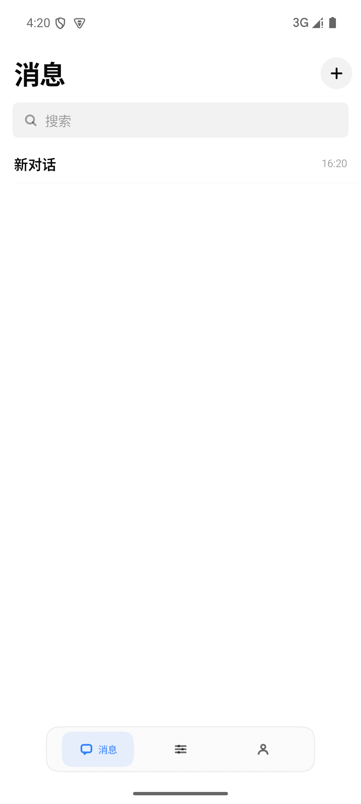
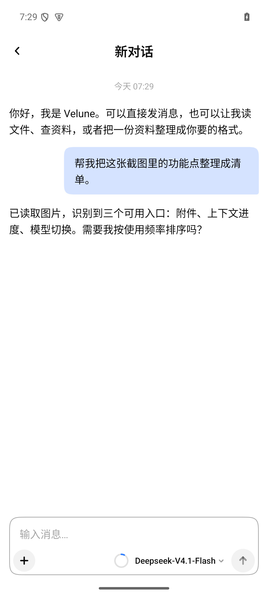
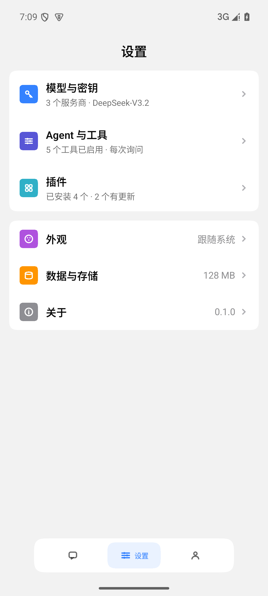
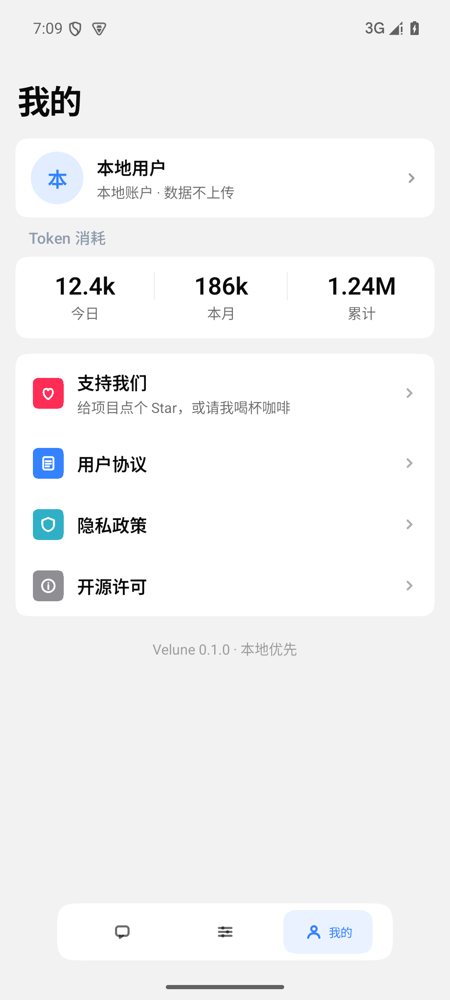

# Velune

Android 原生 AI Agent 聊天应用。Kotlin + Jetpack Compose，本地优先：模型你自己接，数据留在设备上。

<p align="center">
  
  
  
  
</p>

## 特性

- **对话**：多会话管理、流式输出（SSE 逐 token 渲染、可中断）、上下文压缩、角色 / 提示词
- **模型自带**：接入任意 OpenAI 兼容服务商；API Key 经 Android Keystore AES-256-GCM 加密后只存本机
- **Agent 与工具**：只读工具（时间 / 计算 / 搜索 / 应用列表）、MCP 服务器接入、插件
- **Linux 环境**：proot + Ubuntu 用户空间，在手机里跑 Python / Node / Java
- **QQ 机器人**：前台服务保持长连接，官方 Bot 与 OneBot 两种接入，绑定者限定防滥用
- **远程服务器**：SSH 连接自己的机器，让 Agent 在上面执行命令
- **本地化**：深色模式、莫奈取色、字号调节，界面语言对齐 HyperOS 设置

## 系统要求

- Android 8.0+（API 26）
- Android Studio 或本机 Gradle 8.11+；compileSdk 37

## 构建

```bash
./gradlew :app:assembleDebug
# 产物：app/build/outputs/apk/debug/app-debug.apk
```

`local.properties` 里的 `sdk.dir` 由 Android Studio 自动生成，无需提交。

## 模块

```
app/                 壳工程：主题装配、三标签容器、前台服务、协议与政策文本
core/design/         设计系统：token、Squircle 形状、Vx* 组件、自绘图标
core/data/           数据与能力：模型通道、IM、插件、MCP、沙箱、Linux 环境、加密存储
feature/chat/        对话页：消息流、输入栏、上下文环、压缩面板
feature/messages/    消息页：会话列表、搜索
feature/settings/    设置页 / 我的页 / 关于与开源许可
tools/               文档编译与检查脚本
```

## 设计说明

界面度量与动效参考 HyperOS 的设计语言，实现为本项目自绘，未使用任何小米的私有资源（图片、图标、字体）。
各项开源依赖及其许可见应用内「设置 → 关于 → 开源许可」。

## License

本项目以 [GNU AGPL-3.0](./LICENSE) 发布：你可以自由使用、研究、修改和再分发，修改版本（包括仅以网络服务形式提供的）需以同一许可证开放源码。

第三方依赖各自保留其原有许可，清单见应用内「设置 → 关于 → 开源许可」。
